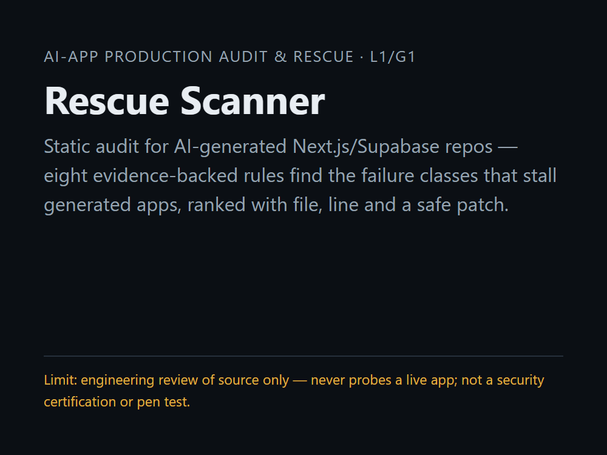

# Rescue Scanner

Static audit for AI-generated Next.js/Supabase repos. Eight evidence-backed rules find the failure classes that stall generated apps — missing RLS, secrets in client code, unvalidated routes, deploy misconfiguration — ranked with file, line, evidence and a suggested patch. A CLI plus a static report.

**Source only:** it reads repository source. It never probes, scans or sends requests to a live deployed app, and it is an engineering review — not a security certification or a penetration test.



## 30 seconds

The static report demo (bundled fixture scan): `site/` after `python scripts/build_demo.py`, or the live Pages export once Fish publishes it. Deep links like `/findings/f-03/` boot offline.

## 2 minutes

```sh
npm ci
npm run scan -- fixtures/bad-app      # 14 findings, exit 2 (high severity present)
npm run scan -- fixtures/clean-app    # 0 findings, exit 0
npm run scan -- <your-repo> --format json
npm run scan -- <your-repo> --format html --out report.html
npm run scan -- <your-repo> --fail-on medium   # exit 2 at/above threshold (CI mode)
```

Node 24+ and npm only — the CLI runs its TypeScript sources directly, no build step, no keys, no network.

## 30 minutes

- `docs/ARCHITECTURE.md` — walker → rules → findings → report data flow.
- `docs/RULES.md` — the eight rules, what each cannot see, and the bad/clean fixture pair per rule.
- `fixtures/` — `bad-app` carries one real defect per rule; `clean-app` is the identical layout remediated, including coverage for every known false-positive shape.
- `docs/CASE_STUDY.md` — a real defect the scanner found in the owner's public `agenttrace` repo, the fix commit, and the false positives the same scan exposed in the scanner itself.
- `scanner/src/` — ~600 lines: `types.ts`, `walk.ts`, `rules.ts`, `scan.ts`, `report.ts`, `cli.ts` plus vitest suites.

Verify everything: `python scripts/verify.py --e2e` (typecheck, lint, vitest suite, demo export, Playwright + axe).

## Rules

`server-secret-in-client` · `missing-rls` · `boundary-leak` · `unsafe-api-route` · `missing-auth-check` · `deploy-misconfig` · `env-misconfig` · `missing-test`

## What it does not do

- Never touches a live deployment, a database, or anyone else's running app.
- Heuristics over source text — it can miss real defects and can flag safe code; every rule documents its blind spot in `docs/RULES.md` and on the report's rules page.
- No auto-fix and no writes by default — it reports; the patch is still yours.

## Part of the stack

[Client Portal](https://github.com/FishRaposo/client-portal) · [Docs Answer](https://github.com/FishRaposo/docs-answer) · [Deploy Doctor](https://github.com/FishRaposo/deploy-doctor) · [Triage Agent](https://github.com/FishRaposo/triage-agent) · [Fix Bench](https://github.com/FishRaposo/fix-bench)

Two flagships and four supporting pieces. Client Portal and Docs Answer carry the deepest work; Deploy Doctor reads the failed build, Rescue Scanner audits the generated app, Triage Agent is the approval-gated workflow, and Fix Bench turns each real defect into a scored task.

## License

MIT. Portfolio piece by Vinícius Raposo — see `docs/CASE_STUDY.md` for the real defect it found and fixed.
